<!-- ================== HEADER ================== -->
<div align="center">



<a href="https://git.io/typing-svg">
  
</a>

<br/>


</div>

---

## ⚙️ DOSSIER

<div align="center">

```
┌──────────────────────────────────────────────────────┐
│  CODENAME   : yusufleonard                           │
│  ROLE       : Full-Stack Engineer / Game Developer   │
│  BASE       : Indonesia 🇮🇩                           │
│  SPECIALTY  : Web • Mobile • DB • UI/UX • 3D • Infra │
│  STATUS     : Not Found 404                          │
│  MOTTO      : --------------------------             │
└──────────────────────────────────────────────────────┘
```

</div>

---

## 🔥 COMBAT SKILLS

| Divisi | Power Level | |
|:--|:--|:--|
| 🌐 **Full-Stack Web** | `██████████` |  |
| 📱 **Mobile Development** | `█████████░` |  |
| 🗄️ **Database Engineering** | `█████████░` |  |
| 🎨 **UI / UX Design** | `████████░░` |  |
| 🎮 **3D Game Development** | `████████░░` |  |
| 🖥️ **Server & DevOps** | `█████████░` |  |

---

## 🛠️ ARSENAL

<div align="center">

**WEB**


**MOBILE**


**DATABASE**


**UI / UX**


**3D & GAME ENGINE**


**SERVER & DEVOPS**


</div>

---

## 📡 CONTACT

<div align="center">

[](https://instagram.com/yusufleonard)
[](https://linkedin.com/in/yusufleonard)
[](mailto:email@kamu.com)
[](https://websitekamu.com)

<br/>


</div>
